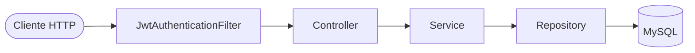
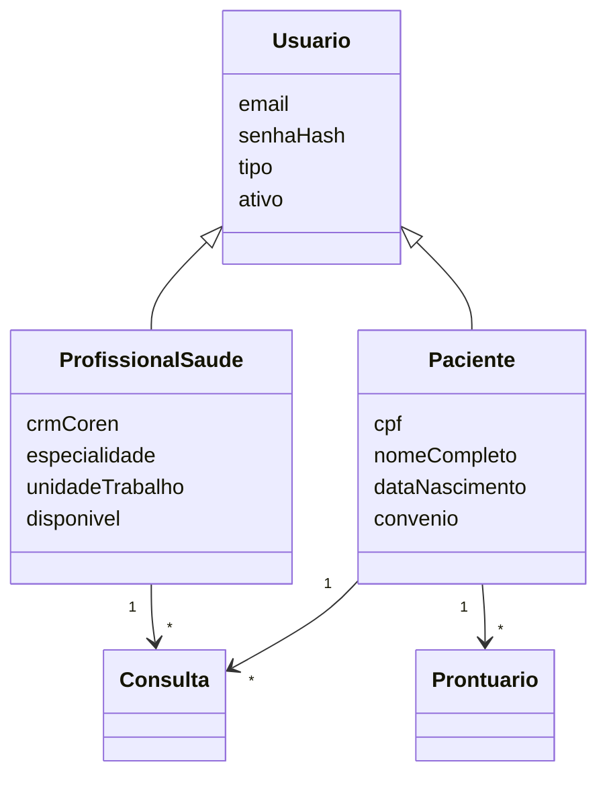

<h1 align="center">🏥 SGHSS — Sistema de Gestão Hospitalar e de Serviços de Saúde</h1>

<p align="center">
  API REST para gestão de pacientes, profissionais de saúde, autenticação e auditoria hospitalar.
</p>

<p align="center">
  
  
  
  
  
  
</p>

<p align="center">
  <a href="https://github.com/CristianoBraga88/SGHSS/actions/workflows/ci.yml"></a>
  <a href="LICENSE"></a>
</p>

<p align="center">
  <a href="#-sobre-o-projeto">Sobre</a> •
  <a href="#-funcionalidades">Funcionalidades</a> •
  <a href="#-arquitetura">Arquitetura</a> •
  <a href="#-como-executar">Como executar</a> •
  <a href="#-documentação-da-api-swagger">Swagger</a> •
  <a href="#-endpoints">Endpoints</a> •
  <a href="#-segurança">Segurança</a> •
  <a href="#-autor">Autor</a>
</p>

---

## 📋 Sobre o projeto

O **SGHSS** é uma API back-end desenvolvida para a instituição fictícia **VidaPlus**, com o objetivo de centralizar o gerenciamento de pacientes, profissionais de saúde, consultas, prontuários e registros de auditoria.

A aplicação segue os princípios **RESTful**, com arquitetura em camadas, autenticação via **JWT** e preocupação com a proteção de dados sensíveis em conformidade com a **LGPD**.

> 🎓 Projeto desenvolvido como trabalho acadêmico da disciplina de **Desenvolvimento Back-End**.

---

## ✨ Funcionalidades

| Módulo | Recursos |
|---|---|
| 🔑 **Autenticação** | Login com JWT, registro de pacientes e profissionais, bloqueio após tentativas de login inválidas |
| 🧑‍🤝‍🧑 **Pacientes** | CRUD completo, busca por CPF, nome e convênio, ativação/inativação, estatísticas |
| 🩺 **Profissionais de saúde** | CRUD completo, busca por CRM/COREN, especialidade e unidade, controle de disponibilidade, estatísticas |
| 📅 **Consultas** | Modelagem de agendamentos vinculados a pacientes e profissionais |
| 📁 **Prontuários** | Modelagem do histórico clínico do paciente |
| 🛡️ **Auditoria** | Registro de ações realizadas no sistema (`LogAuditoria`) |

---

## 🏗️ Arquitetura

O projeto adota uma **arquitetura em camadas**, separando responsabilidades para facilitar manutenção, testes e evolução:



```
src/main/java/br/com/vidaplus/sghss_api
├── config/        # Configurações (CORS, ModelMapper, carga inicial do banco)
├── controller/    # Endpoints REST (Auth, Pacientes, Profissionais)
├── exception/     # Exceções de domínio e tratamento global de erros
├── model/         # Entidades JPA (Usuario, Paciente, ProfissionalSaude, Consulta, Prontuario, LogAuditoria)
├── repository/    # Interfaces Spring Data JPA
├── security/      # JWT, filtro de autenticação, Spring Security, controle de tentativas de login
└── service/       # Regras de negócio
```

### Modelo de domínio



---

## 🚀 Tecnologias

- **Java 17**
- **Spring Boot 4.0.0** (Web MVC, Data JPA, Validation, DevTools)
- **Spring Security** + **JWT** (`com.auth0:java-jwt`)
- **Hibernate / JPA**
- **MySQL**
- **Lombok**
- **ModelMapper**
- **springdoc-openapi** (Swagger UI)
- **JUnit 5** + **H2** (testes)
- **Docker** / **Docker Compose**
- **GitHub Actions** (integração contínua)
- **Maven** (wrapper incluso)

---

## ⚙️ Como executar

### Opção 1 — Docker (recomendado)

Com o [Docker](https://www.docker.com/) instalado, basta um comando para subir a API e o MySQL:

```bash
git clone https://github.com/CristianoBraga88/SGHSS.git
cd SGHSS
docker compose up --build
```

### Opção 2 — Localmente

**Pré-requisitos:** [JDK 17+](https://adoptium.net/) e [MySQL 8+](https://dev.mysql.com/downloads/) rodando na porta `3306`.

```bash
# 1. Clone o repositório
git clone https://github.com/CristianoBraga88/SGHSS.git
cd SGHSS

# 2. Configure as variáveis de ambiente (ou edite application.properties)
export DB_USERNAME=root
export DB_PASSWORD=sua_senha
export JWT_SECRET=uma_chave_secreta_com_pelo_menos_32_caracteres

# 3. Execute a aplicação
./mvnw spring-boot:run        # Linux/macOS
mvnw.cmd spring-boot:run      # Windows
```

Em ambos os casos, a API fica disponível em **http://localhost:8080** e o banco `sghss_db` é criado automaticamente.

### Variáveis de ambiente

| Variável | Descrição | Padrão |
|---|---|---|
| `DB_USERNAME` | Usuário do MySQL | `root` |
| `DB_PASSWORD` | Senha do MySQL | — |
| `JWT_SECRET` | Chave de assinatura dos tokens (mín. 32 caracteres) | chave de desenvolvimento |

### Executando os testes

Os testes usam um banco **H2 em memória**, sem necessidade de MySQL:

```bash
./mvnw test
```

### Usuário administrador padrão

Na primeira inicialização, um usuário administrador é criado automaticamente:

| E-mail | Senha |
|---|---|
| `admin@hospital.com` | `admin123` |

> ⚠️ Altere essa senha em qualquer ambiente que não seja de desenvolvimento.

---

## 📖 Documentação da API (Swagger)

Com a aplicação rodando, acesse a documentação interativa:

- **Swagger UI:** http://localhost:8080/swagger-ui.html
- **OpenAPI JSON:** http://localhost:8080/v3/api-docs

Para testar rotas protegidas, faça login em `/api/auth/login`, copie o token e clique em **Authorize** no Swagger.

---

## 📡 Endpoints

### 🔑 Autenticação — `/api/auth`

| Método | Rota | Descrição |
|---|---|---|
| `POST` | `/login` | Autentica o usuário e retorna o token JWT |
| `POST` | `/registrar/paciente` | Registra um novo paciente |
| `POST` | `/registrar/profissional` | Registra um novo profissional de saúde |
| `GET` | `/health` | Verifica se a API está no ar |

### 🧑‍🤝‍🧑 Pacientes — `/api/pacientes`

| Método | Rota | Descrição |
|---|---|---|
| `POST` | `/` | Cadastra paciente |
| `GET` | `/` | Lista pacientes |
| `GET` | `/{id}` | Busca por ID |
| `GET` | `/cpf/{cpf}` | Busca por CPF |
| `GET` | `/buscar` | Busca por filtros |
| `GET` | `/convenio/{convenio}` | Lista por convênio |
| `GET` | `/estatisticas` | Estatísticas de pacientes |
| `PUT` | `/{id}` | Atualiza paciente |
| `PATCH` | `/{id}/status` | Ativa/inativa paciente |
| `DELETE` | `/{id}` | Remove paciente |

### 🩺 Profissionais — `/api/profissionais`

| Método | Rota | Descrição |
|---|---|---|
| `POST` | `/` | Cadastra profissional |
| `GET` | `/` | Lista profissionais |
| `GET` | `/{id}` | Busca por ID |
| `GET` | `/crm-coren/{crmCoren}` | Busca por CRM/COREN |
| `GET` | `/especialidade/{especialidade}` | Lista por especialidade |
| `GET` | `/unidade/{unidade}` | Lista por unidade |
| `GET` | `/disponiveis` | Lista profissionais disponíveis |
| `GET` | `/estatisticas` | Estatísticas de profissionais |
| `PUT` | `/{id}` | Atualiza profissional |
| `PATCH` | `/{id}/status` | Ativa/inativa profissional |
| `PATCH` | `/{id}/disponibilidade` | Altera disponibilidade |
| `DELETE` | `/{id}` | Remove profissional |

### Exemplo de login

```http
POST /api/auth/login
Content-Type: application/json

{
  "email": "admin@hospital.com",
  "senha": "admin123"
}
```

Use o token retornado no cabeçalho das próximas requisições:

```http
Authorization: Bearer <seu_token>
```

---

## 🔐 Segurança

- Autenticação **stateless** com **JWT** (expiração de 24h e refresh token de 7 dias)
- Senhas armazenadas com hash (**BCrypt**)
- Bloqueio temporário após múltiplas tentativas de login inválidas (`LoginAttemptService`)
- Tratamento global de exceções com respostas padronizadas (`GlobalExceptionHandler`)
- Registro de auditoria das ações no sistema
- Configuração de **CORS**
- Boas práticas alinhadas à **LGPD** para dados sensíveis de saúde

---

## 🗺️ Próximos passos

- [x] Documentação interativa com Swagger / OpenAPI
- [x] Containerização com Docker / Docker Compose
- [x] Pipeline de CI com GitHub Actions
- [ ] Endpoints REST para consultas e prontuários
- [ ] Autorização por perfil (ADMIN, PROFISSIONAL, PACIENTE) nas rotas
- [ ] Ampliar cobertura de testes unitários e de integração

---

## 👨‍💻 Autor

**Cristiano Braga**

[](https://github.com/CristianoBraga88)

---

## 📝 Licença

Este projeto está sob a licença **MIT**. Veja o arquivo [LICENSE](LICENSE) para mais detalhes.

---

<p align="center">Feito com ☕ e Spring Boot</p>
